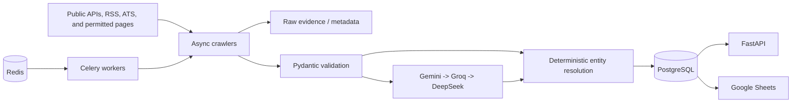

# GraphOne Intelligence

GraphOne Intelligence is a modular, production-oriented platform for traceable AI startup, product, research-paper, news, and job intelligence.

It deliberately separates source acquisition, normalized output, provenance evidence, deterministic entity resolution, LLM assistance, and exports. Missing evidence remains `null`, ambiguous entities remain in review, and unverified fresh records are quarantined.

## Architecture diagram



## Overall architecture

Source adapters -> bounded async HTTP crawlers -> Pydantic validation -> LLM extraction -> deterministic entity resolution -> PostgreSQL deduplication -> API/export pipelines.

Redis coordinates distributed tasks and rate limits. PostgreSQL is authoritative. Qdrant is reserved for optional semantic retrieval; it never overrides deterministic entity resolution.

## Final folder structure

```text
graphone-intelligence/
├── src/
│   ├── config/
│   ├── api/
│   ├── crawlers/
│   ├── extractors/
│   ├── processors/
│   ├── llm/
│   ├── resolution/
│   ├── storage/
│   ├── pipelines/
│   ├── exporters/
│   ├── workers/
│   └── utils/
├── tests/
├── scripts/
├── data/raw/
├── data/processed/
├── data/exports/
├── docs/
├── Dockerfile
├── docker-compose.yml
├── requirements.txt
├── requirements-dev.txt
├── .env.example
├── README.md
└── main.py
```

## Three-day roadmap

1. **Day 1:** Foundation, PostgreSQL/SQLite storage, source adapters, arXiv and GitHub, startup/product ingestion, tests.
2. **Day 2:** News/jobs freshness, LLM fallback/chunking, entity resolution, remaining models and Celery tasks.
3. **Day 3:** Google Sheets, API completion, Docker validation, PDF architecture, test suite, and honest data-count reporting.

## Dependency list

Python 3.12+, FastAPI, Pydantic, SQLAlchemy/Alembic, aiohttp, BeautifulSoup/lxml, Playwright, feedparser, Pandas, RapidFuzz, Redis, Celery, PostgreSQL, Qdrant, and Google Sheets API. Development dependencies are in `requirements-dev.txt`.

## Environment variables

Copy `.env.example` to `.env`. Supply provider keys only where used. `GITHUB_TOKEN` is required for GitHub star enrichment; without it, repository URLs are retained and star lookups are deferred. PostgreSQL and Redis are configured by Docker Compose.

## Phase 1 setup

Phase 1 crawls legitimate Hugging Face organization/Space pages and arXiv. GitHub stars are obtained only through the GitHub REST API. No startup, product, paper, or URL is synthesized.

```powershell
cd C:\projects\ai\graphone-intelligence
py -3.12 -m venv .venv
.venv\Scripts\Activate.ps1
pip install -r requirements-dev.txt
pytest -q
uvicorn src.api.app:app --reload
```

Docker:

```powershell
copy .env.example .env
docker compose up --build
```

API health: `http://localhost:8000/health`

## Acceptance status

- Startups: source-backed Phase 1 adapter implemented; no fabricated baseline count is claimed.
- Products: source-backed Hugging Face adapter implemented; pricing remains `UNKNOWN` unless explicit data exists.
- Research: source-backed arXiv adapter uses one bounded result budget across the selected categories and spaces API requests at least three seconds apart. GitHub stars are fetched from the GitHub REST API when `GITHUB_TOKEN` is configured; otherwise linked repository URLs are retained and metrics remain unset for later enrichment.
- News: five RSS source definitions and strict UTC 24-hour filtering. Missing or unverifiable dates are quarantined.
- Jobs: five configured ATS source definitions. Missing dates or URLs are quarantined.
- LLM: Gemini, Groq, and DeepSeek adapters with provider fallback, Pydantic validation, token-aware chunking, 429/413 handling, usage counters, and persisted failed tasks.
- Entity resolution: 50 verified startup seeds, exact/alias-first matching, conservative 96% RapidFuzz threshold, canonical IDs, and human-review queue.
- Anti-bot: authorized Playwright fallback, per-domain pacing, randomized polite delays, 429 retry handling, circuit breakers, block detection, and `/api/crawl/status` metrics.
- Validation: strict export schemas, timezone-aware UTC timestamps, HTTP(S) provenance URLs, explicit `UNKNOWN` pricing, and no invented optional values.
- Database: Alembic migration support, UUID models, unique source URLs/content hashes, ingestion run and crawl task persistence, GitHub repository metrics, and transactional upsert utilities.
- Google Sheets: six-tab batch export, primary-key checkpoints, quota retry, and service-account setup.
- Monitoring: JSON structured logs, request/run/task identifiers, runtime counters, extraction failure counts, database health, and ingestion run persistence.

## Database migration commands

```powershell
cd C:\projects\ai\graphone-intelligence
.venv\Scripts\python.exe -m alembic upgrade head
.venv\Scripts\python.exe scripts\seed_entities.py
```

## Pipeline and export scripts

Dedicated CLI scripts are available in `scripts/`:

- `scripts\run_all.py`: Orchestrates Phase 1 and Phase 2 ingestion in a single pass.
- `scripts\run_phase1.py`: Ingests startups, products, and arXiv research papers.
- `scripts\run_phase2.py`: Ingests verified 24-hour news articles and ATS job postings.
- `scripts\enrich_github_stars.py`: Enriches research papers with live GitHub star counts.
- `scripts\export_csv.py`: Exports all 6 canonical tabs to CSV in `data/exports/` for immediate import.
- `scripts\export_sheets.py`: Syncs all 6 tabs directly to Google Sheets using service account credentials.
- `scripts\generate_architecture_pdf.py`: Recompiles the 3-page `architecture.pdf` design specification.

## Testing

The test suite uses mocked providers and a controlled fixture dataset; basic tests do not call live third-party APIs.

```powershell
cd C:\projects\ai\graphone-intelligence
.venv\Scripts\python.exe -m pytest -q
.venv\Scripts\python.exe -m ruff check src tests migrations scripts
```

## Docker deployment

```powershell
copy .env.example .env
docker compose up --build
```

The Compose stack starts PostgreSQL, Redis, API, migration/seed initialization, and Celery worker services. Live provider credentials remain optional and must be supplied through `.env`.

## API endpoints

| Method | Endpoint | Purpose |
|---|---|---|
| GET | `/health` | Database-backed service health |
| GET | `/api/stats` | Record and extraction metrics |
| POST | `/api/crawl/startups` | Start startup ingestion |
| POST | `/api/crawl/products` | Start product ingestion |
| POST | `/api/crawl/research` | Start arXiv/repository ingestion |
| POST | `/api/crawl/news` | Start verified 24-hour news ingestion |
| POST | `/api/crawl/jobs` | Start verified 24-hour job ingestion |
| POST | `/api/pipeline/run` | Run the combined news/job pipeline |
| GET | `/api/pipeline/status` | Extraction task status |
| GET | `/api/entities` | List canonical entities |
| GET | `/api/crawl/status` | Source block and checkpoint metrics |
| GET | `/api/exports/status` | Six-tab export checkpoint status |
| POST | `/api/exports/run` | Start Google Sheets export |

## Google Sheets setup

1. Create a Google Cloud service account and enable the Google Sheets API.
2. Download its JSON credential file outside the repository.
3. Share the target spreadsheet with the service account email.
4. Set `GOOGLE_SHEETS_SPREADSHEET_ID` and `GOOGLE_APPLICATION_CREDENTIALS`.
5. Call `POST /api/exports/run`. The exporter creates missing tabs and writes in batches.

## Limitations

- Live crawling results depend on source availability, robots rules, and API terms.
- Missing publication timestamps are quarantined, not inferred.
- Provider keys are required for live LLM extraction.
- Google Sheets credentials are required for live exports.
- A smaller verified live dataset is preferable to fabricated records.

## Scaling strategy

Scale API and Celery worker replicas independently, preserve bounded concurrency, partition large timestamp tables, and keep source and content deduplication constraints in PostgreSQL. Redis handles coordination. Qdrant remains optional and never replaces deterministic entity resolution.
